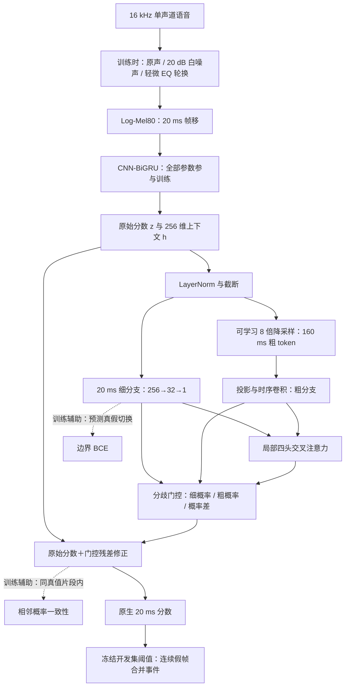

# 主方案方法论：带边界辅助的双分辨率 CNN-BiGRU

当前主方案对应实验组 `boundary`：**CNN-BiGRU＋信道增强＋20/160 ms 双分支＋局部交叉注意力＋分歧门控＋边界辅助组合**。CNN 和新增模块全部端到端训练；当前权重从随机初始化训练得到，不是冻结旧 CNN 后只训练修正头。

选择该组作为工程主线，是查看本轮 PS 对照结果后的决定。此次调整不重新选择 epoch、阈值或测试工作点，也不产生一份新的盲测结果。四组原始对照仍保留。

## 1. 任务与设计思路

输入一段语音，模型要标出其中哪些时间区间是伪造语音。输出为每 20 ms 一个假语音分数，再将连续预测为假的帧合并成事件。

设计目标是同时利用细节与上下文：20 ms 分支保留较细的定位网格，160 ms 分支提供跨帧信息；细帧查询附近粗 token 后，由门控学习两条分支各自应该贡献多少修正。边界辅助组合进一步提供“真假何时切换”的训练信号，以及“同一真值片段内部相邻预测应较一致”的约束。

这些是设计动机，不代表网络已经学会某条人为规则。例如，不能事先断言“短事件一定更多相信细分支”，也不能仅凭结构就声称减少了事件碎裂。当前“双分辨率”是两种时间网格，共用同一套 Log-Mel 特征，不是两套声学窗长。

开发集和测试集只使用原声。BiGRU 已经使用整条录音的前后文，因此这是**离线定位模型**；局部注意力不使整个模型变成流式模型。

## 2. 输入、增强与 CNN-BiGRU

音频采样率为 16 kHz、单声道。Log-Mel 使用 80 个频带，FFT 长度 512，窗长 400 个采样点（25 ms），帧移 320 个采样点（20 ms）。波形按存储网格补零，前端按帧中点对齐；真实不足 20 ms 的末帧保留其实际时长，补零帧的监督时长为零。

训练集为每条完整录音预先计算三种确定性视图，每轮只取其中一种，按平衡的 UID 分配和轮数轮换，不把一条录音每轮重复三遍：

| 视图 | 实际操作 |
|---|---|
| 原声 | 波形保持不变 |
| 20 dB 白噪声 | 生成去均值的高斯噪声，按原语音 RMS 将噪声 RMS 缩放到其约 1/10，再相加；每条 UID 的噪声种子固定 |
| 轻微 EQ | 对波形执行 `x[n] + 0.15 × (x[n] − x[n−1])`；首个前驱值取首采样点，避免额外首端跳变 |

这些变换保持采样点数和标签位置。缓存只保存声学前端结果，不缓存冻结 CNN 的特征；CNN 在每轮仍然更新。

骨干先对 80 维输入做 LayerNorm，再经过三层 `3×3 Conv2d → ReLU → 频率方向 MaxPool(1,2)`，通道数依次为 16、32、64。池化不降低时间分辨率。之后是两层双向 GRU，每个方向 hidden size 为 128，形成每帧 256 维上下文 `h_t`；分类头产生假为正类的 logit `z_t`。本轮 dropout 为 0.4。

骨干参数为 911,521，主方案新增模块参数为 25,493，总参数为 937,014。

## 3. 双分支、注意力与残差门控

以下均描述有效时间格；令 `w_t` 为第 `t` 个细帧的实际时长，完整帧为 0.02 秒，无效补零格为 0。每八个细帧组成粗块 `B_k`，其有效时长为 `W_k = Σ(t∈B_k) w_t`。

**细分支。** 先计算 `ĥ_t = clip(LayerNorm(h_t), −5, 5)`。这里是可训练的逐帧 LayerNorm，不读取旧 CNN 的均值/标准差文件。随后：

$$
u_t=\operatorname{GELU}(W_f\hat h_t+b_f),\qquad
r^f_t=w_f^\top u_t+b_f^{out}.
$$

`u_t` 为 32 维，`r^f_t` 是细分支对原始 logit 的残差修正。

**可学习粗分支。** 对 `ĥ` 做逐通道的 `Conv1d(kernel=8, stride=8, groups=256, bias=False)`。若用 `K_{d,j}` 表示第 `d` 个特征通道、第 `j` 个块内位置的权重，则有效粗块的输入为：

$$
c_{k,d}=\sum_{j=0}^{7}K_{d,j}\,
\frac{8w_{8k+j}}{W_k}\,\hat h_{8k+j,d}.
$$

所有 `K` 初始为 `1/8`，所以初始等价于有效时长加权均值；后续可学习各通道不同块内位置的权重。它不是普通非重叠均值，也不是自动保证保留边界的算子。无效粗块被屏蔽。

粗 token 经 `256→32` 投影、GELU、核大小为 3 的时序卷积和 GELU，得到 32 维特征 `v_k`，再经线性层产生残差 `r^c_k`。原始粗分数为有效时长加权的 `z_t` 均值：

$$
\bar z_k=\frac{\sum_{t\in B_k}w_tz_t}{W_k},\qquad
z^c_k=\bar z_k+r^c_k.
$$

**局部交叉注意力。** 细特征 `u_t` 作 Query，粗特征 `v_k` 作 Key/Value。四个注意力头各为 8 维，只查询对应粗块及前后各两块：

$$
\mathcal N(t)=\{\lfloor t/8\rfloor-2,\ldots,\lfloor t/8\rfloor+2\},
\qquad
\alpha^{(m)}_{t,k}=\operatorname{softmax}_{k\in\mathcal N(t)}
\left(\frac{q_t^{(m)\top}k_k^{(m)}}{\sqrt 8}\right).
$$

越界或无效块不参与 softmax。四头上下文拼接后经线性层产生注意力残差 `r^a_t`。代码只收集这五个候选粗块，不建立整段 `T×C` 注意力矩阵；粗分支的核 3 卷积还扩展一格粗块范围，但骨干的 BiGRU 已具有整段上下文。

**分歧门控。** 当前门控只有三个输入，不包含边界预测、熵或相对位置偏置：

$$
p^f_t=\sigma(z_t+r^f_t),\qquad
p^c_t=\sigma(\bar z_{\lfloor t/8\rfloor}+r^c_{\lfloor t/8\rfloor}+r^a_t),
$$

$$
g_t=\sigma\left(\operatorname{MLP}_{3\to16\to1}
\left[p^f_t,p^c_t,|p^f_t-p^c_t|\right]\right),
$$

$$
\ell_t=z_t+(1-g_t)r^f_t+g_t\left(r^c_{\lfloor t/8\rfloor}+r^a_t\right).
$$

门控 MLP 中间使用 GELU。最终融合的是**logit 残差**，没有直接用粗概率覆盖细概率。细、粗和注意力残差输出层均零初始化，初始 `ℓ_t=z_t`，与同一随机 CNN 的输出一致。无效存储尾帧的残差固定为零，保留其原始 `z_t`。

## 4. 边界辅助与联合损失

边界头为细特征 `u_t` 上的 `Linear(32,1)`，监督目标为相邻有效细帧是否发生真假切换：`b_t = 1[y_t ≠ y_(t−1)]`。切换归到后一帧，首帧不监督；有效相邻权重为 `min(w_t,w_(t−1))`。边界头只提供训练辅助，当前不直接参与门控、不用来后处理或移动预测边界，推理时也不需要真值边界。

段内一致性仅约束同一真值类别的相邻有效帧：

$$
L_{cons}=\frac{\sum_t a_t\,[\sigma(\ell_t)-\sigma(\ell_{t-1})]^2}{\sum_t a_t},
\qquad
a_t=\min(w_t,w_{t-1})\,\mathbf 1[y_t=y_{t-1}].
$$

无有效相邻对时该项为零。约束不跨真假边界，也不跨录音。它旨在鼓励段内一致，不能直接等同于“事件碎裂一定减少”。

主方案的总损失为：

$$
L=L_{20}^{final}+L_{160}^{final}
+0.5L_{160}^{coarse}+0.1L_{boundary}+0.05L_{cons}.
$$

| 项目 | 监督对象与权重 |
|---|---|
| `L20_final` | 最终原生 20 ms logit `ℓ_t` 与实际细标签，按真实细帧时长加权 BCE |
| `L160_final` | 每八个**存储**细 logit 的普通均值，与官方 160 ms 标签计算真实粗格时长加权 BCE |
| `L160_coarse` | 独立粗分支 logit `zᶜ_k` 与官方粗标签计算时长加权 BCE |
| `Lboundary` | 边界头与上述切换标签计算有效相邻时长加权 BCE |
| `Lcons` | 同类别有效相邻最终概率差的平方 |

各项在整个 batch 的相关时长上归一化，不是先逐录音平均。实际细标签为 `1=假`；官方粗标签原为 `1=真`，读取时转换。

必须区别两个粗尺度计算：独立粗分支形成特征和原始粗分数时屏蔽无效尾帧；`L160_final` 延续四组共同的普通 `mean8` 定义，仍包含补齐粗格后的存储尾帧 logit。尾帧不参与 20 ms 损失，粗格损失按该格真实时长计。当前没有短困难事件额外权重，也没有直接优化可微事件 F1；事件 F1 用于开发集选模。

## 5. 训练、选模与评价

本轮固定 PS `train=6,345 / dev=2,484 / eval=3,562`，seed666。四组 CNN 初始张量一致，数据顺序和更新预算一致；主方案从随机初始化训练 20 轮，batch size 为 8，每轮 794 次更新，共 15,880 次。CNN、LayerNorm、两分支、注意力、门控、可学习降采样和边界头全部参与更新。AdamW 学习率统一 `1e−3`，weight decay 为 `1e−4`，整体梯度裁剪阈值为 5。

完整录音进入 CNN-BiGRU，新增模块逐录音前向，避免跨录音注意力。每轮结束只在原声开发集执行以下步骤：

1. 以所有真实区域的实际秒数为分母，确定使真实时长误报率不超过 5% 的最宽松分数边界；相同分数的一组帧不能拆开。真实区域包含部分伪造录音中的真实部分。
2. 在该阈值下计算开发集事件 F1，选取最高轮；`epoch0` 可选，差异不超过 `1e−10` 个百分点时保留较早轮次。
3. 冻结权重与该轮开发集阈值后评估测试集。测试集不搜索阈值或选 epoch；5% 不约束测试集实际误报率。

当前主方案选中 **epoch19**，假为正类的原生 20 ms **logit 阈值为 `0.42304700613021856`**，决策使用 `float64(score) >= float64(threshold)`，不能把此数值当 sigmoid 概率阈值。权重为 [cnn_boundary_ps_eventf1_seed666.pt](../weights/cnn_boundary_ps_eventf1_seed666.pt)，完整 SHA 与配置见 [manifest](../weights/manifest.json)。

主指标为原生 20 ms 的事件 F1：连续假帧合并为半开时间区间，末端截到实际录音时长，不平滑、不补空隙、不删除短事件。预测区间与真值在每条录音内按 `IoU≥0.5` 一对一匹配，先最大化匹配数，再最大化总 IoU；随后汇总全测试集计数。令 `M` 为匹配数、`P` 为预测事件总数、`G` 为真值事件总数，则事件 Precision=`M/P`、Recall=`M/G`、F1=`2M/(P+G)`。

事件 F1 按事件计数，能够补充时长指标对长事件的偏重；同时保留以下辅助指标，观察代价：

- ≤320 ms 短事件召回：在同一组全事件匹配中，短真值事件的匹配数除以短真值事件总数。
- 真实时长误报率：真实区域中被判为假的秒数除以真实总秒数。
- 全真录音误报率：至少出现一次报警的全真录音数除以全真录音总数。
- Frame F1、时长 F1、EER 作为补充，不参与本轮选模；无定义分母输出空值。

5%、320 ms 和 IoU0.5 是本研究选定的评价设置，不是领域统一标准。

## 6. 结果与可支持的结论

四组的固定阈值测试与独立复算均已完成。结果均为百分比：

| 方案 | 事件 P | 事件 R | 事件 F1 | ≤320 ms 召回 | 真实时长误报率 | 全真录音误报率 |
|---|---:|---:|---:|---:|---:|---:|
| 原 CNN 结构重训 | 46.53 | 62.14 | 53.22 | 63.83 | 6.40 | 25.21 |
| CNN＋信道增强 | 46.85 | 54.09 | 50.21 | 56.58 | 4.94 | 12.33 |
| 再加双分支、注意力、门控与粗辅助监督 | 50.79 | 59.93 | 54.98 | 61.39 | 6.03 | 15.62 |
| **再加边界辅助组合：当前主方案** | **50.91** | **61.35** | **55.65** | **65.30** | **4.02** | **10.14** |

当前主方案相对增强对照的事件 F1 增加 **5.43 个百分点**，相对原 CNN 重训增加 **2.43 个百分点**，并在表中的短事件召回和两类误报率取得本轮最好的点估计。因此将其作为后续工程主线；这不等于已经确认它在重复训练中稳定胜出。

其中，双分辨率组合相对增强对照的事件 F1 增加 4.7709 个百分点，2,000 次配对录音 bootstrap 的 95% 区间为 `[3.9094, 5.5684]`；边界组合相对双分辨率组只再增加 0.6631 个百分点，区间 `[-0.1059, 1.4519]` 跨 0。此探索性区间只反映固定模型下录音重采样的不确定性，未校正多重比较，也不覆盖训练种子差异。

需要同时披露：

- 主方案事件 Recall 61.35% 和 Frame F1 71.14%，低于原 CNN 重训的 62.14% 和 74.08%。
- ≤320 ms 的增益主要来自 ≤80 ms；80–160 ms、160–320 ms 的召回低于双分辨率组，不能声称各种长度都改善。
- 主方案未匹配预测事件为 6,760 个，双分辨率组为 6,634 个；开发集碎片化代理计数也从 219 增至 268。时长误报下降不意味着所有误报事件计数下降，也没有证实减少了碎片化。
- 双分辨率组同时改变结构和粗辅助监督；边界组合又同时增加可学习降采样、边界 BCE、段内一致性，现有四组不能把收益单独归因于某个模块。
- 目前只有 seed666，eval 此前也已被分析。按组员文字重建实现的结果，不能等同于复现其未取得的原始代码；当前也没有证据支持“完全首创”或跨数据集泛化结论。

完整精度、分箱和审计记录见 [结果 JSON](results_four_eventf1_20261115.json) 与 [中文结果说明](results_four_eventf1_20261115.txt)。

## 7. 代码核查入口

| 内容 | 代码位置 |
|---|---|
| 当前主方案训练、冻结与评估入口 | [main_method.py](../code/cnn_ps/main_method.py)：固定选择 `boundary`，复用原训练与评价实现 |
| 无需标签的单音频推理 | [predict_main.py](../code/cnn_ps/predict_main.py)：完整加载 CNN/adapter，读取权重内的开发集阈值 |
| 本轮主方案定义、随机初始化、联合优化、开发集选模与冻结 | [train_four.py](../code/cnn_ps/train_four.py)：`ARMS['boundary']`、`train_arm`、`freeze_eval_plan` |
| CNN、BiGRU、Log-Mel 与原生 20 ms 输出 | [backbone.py](../code/cnn_ps/backbone.py)：`LogMel`、`CNNBiGRU` |
| 三种波形视图 | [augmentation.py](../code/cnn_ps/augmentation.py)：`transform` |
| 特征缓存及通道读取 | [dual_features.py](../code/cnn_ps/dual_features.py)：`build_feature_cache`、`FeatureData` |
| 双分支、可学习降采样、交叉注意力、门控与边界头 | [dual_resolution.py](../code/cnn_ps/dual_resolution.py)：`DualResolutionAdapter` |
| 当前训练复用的前向、边界目标和损失函数 | [train_dual.py](../code/cnn_ps/train_dual.py)：`forward_batch`、`boundary_targets`、`training_loss`、`infer` |
| 共同 20/160 ms 损失与时长权重 | [finetune.py](../code/cnn_ps/finetune.py)：`objective`、`fine_collate` |
| 阈值、区间和事件指标 | [metrics20.py](../code/cnn_ps/metrics20.py)、[report_native20.py](../code/cnn_ps/report_native20.py) |

`train_dual.py`、`finetune.py` 中的旧 CLI 和部分历史说明保留用于回溯；上表只复用列出的共享函数。当前实验训练入口为 `train_four --arm boundary` 及仓库主方案入口，采用随机初始化和纯开发集事件 F1 选模，不执行旧 CLI 的预训练起点或旧 J 规则。
