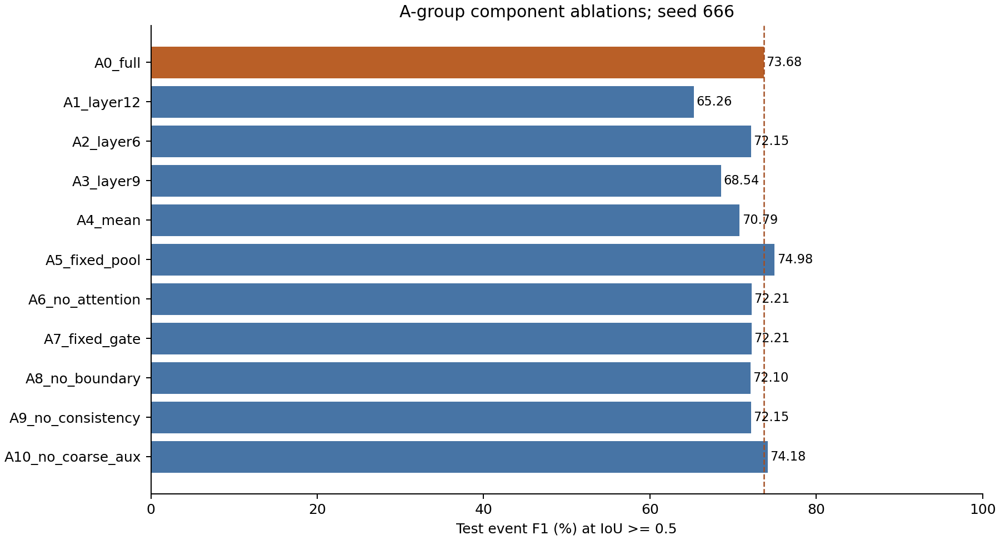
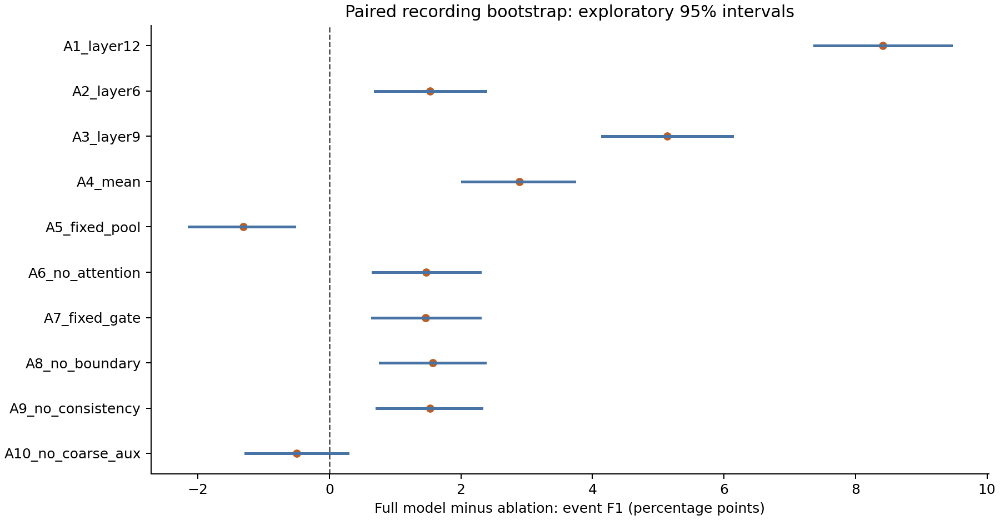
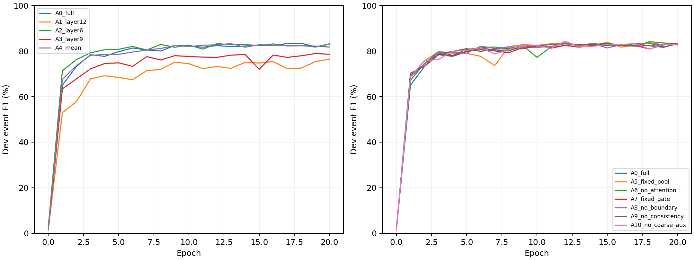

# 冻结WavLM：A组模块消融验证报告

本次完成A0—A10共11种设置：A0/A1复用已完成的同条件20轮结果，新增9组均从同一随机初始化训练20轮。复用前，全开发集分数及CPU/GPU单步更新通过逐元素一致性检查；训练总预算、模型选择规则一致。

这里检验的是当前WavLM特征方案及其任务后端、辅助损失的条件贡献。未拆除WavLM编码器内部的Transformer、卷积或位置编码；内部结构属于后续实验。

## 实验设置

- 固定训练6,345条、开发2,484条、测试3,562条；UID互不重叠。训练使用同一套三视图缓存，开发/测试只用干净视图。
- 编码器94,381,936个参数全部冻结。每组seed=666、20轮、15,880次更新、batch=8、AdamW lr=0.001、weight decay=0.0001、梯度裁剪5。
- 共享参数初始化、数据顺序相同；两个独立进程运行，模型与随机状态不共享。训练耗时受并发影响，不用于推理速度比较。
- 每组单独用开发集校准真实时长FPR≤5%的阈值，再选择开发集事件F1最高的轮次；epoch0可参与，平分保留较早轮次。
- 全部组训练完成后冻结最佳权重及阈值，才读取本次新增模型的测试结果；无测试集调阈值、选轮次或早停。
- 所有原有代码文件保持原样，新代码和结果独立保存。

| 组别 | 唯一变化 |
|---|---|
| A0_full | 完整方案：6/9/12层可学习融合，全部模块开启 |
| A1_layer12 | 仅第12层 |
| A2_layer6 | 仅第6层 |
| A3_layer9 | 仅第9层 |
| A4_mean | 6/9/12层固定等权平均 |
| A5_fixed_pool | 可学习降采样改为按有效时长平均 |
| A6_no_attention | 关闭局部跨分辨率注意力残差，保留粗分支和门控 |
| A7_fixed_gate | 可学习门控改为固定0.5，保留注意力 |
| A8_no_boundary | 关闭边界辅助头及其损失，保留一致性 |
| A9_no_consistency | 关闭段内一致性损失，保留边界头 |
| A10_no_coarse_aux | 关闭粗分支辅助损失，保留粗分支和主160ms损失 |

## 测试集指标

指标单位为%，差值单位为百分点；事件F1为主要指标，其他指标用于判断精确率、召回率及误报的取舍。

| 组别 | 事件F1↑ | 相对A0差值 | 事件P↑ | 事件R↑ | 短事件R↑ | 真实时长FPR↓ | 帧F1↑ | 帧EER↓ |
|---|---:|---:|---:|---:|---:|---:|---:|---:|
| A0_full | 73.6767 | +0.0000 | 70.9014 | 76.6780 | 72.6020 | 5.7043 | 90.0013 | 8.4517 |
| A1_layer12 | 65.2588 | -8.4179 | 61.7179 | 69.2308 | 66.7273 | 6.8283 | 84.4350 | 12.3540 |
| A2_layer6 | 72.1486 | -1.5281 | 68.2841 | 76.4768 | 72.7580 | 6.7174 | 88.7358 | 9.4316 |
| A3_layer9 | 68.5384 | -5.1383 | 65.3111 | 72.1012 | 69.3787 | 6.0191 | 86.4053 | 10.7726 |
| A4_mean | 70.7887 | -2.8880 | 67.1110 | 74.8928 | 71.0944 | 6.9053 | 88.5390 | 9.3709 |
| A5_fixed_pool | 74.9844 | +1.3077 | 71.3383 | 79.0234 | 75.8773 | 6.2927 | 90.0436 | 8.0846 |
| A6_no_attention | 72.2070 | -1.4697 | 67.9266 | 77.0631 | 74.3306 | 6.6959 | 87.9207 | 10.4537 |
| A7_fixed_gate | 72.2108 | -1.4659 | 68.3606 | 76.5205 | 73.4079 | 5.9971 | 88.4818 | 9.6861 |
| A8_no_boundary | 72.1037 | -1.5730 | 69.4471 | 74.9716 | 71.0424 | 6.5405 | 88.8672 | 9.4765 |
| A9_no_consistency | 72.1477 | -1.5290 | 67.7608 | 77.1419 | 73.5768 | 6.5730 | 88.9296 | 9.3969 |
| A10_no_coarse_aux | 74.1758 | +0.4992 | 71.1393 | 77.4832 | 73.7588 | 6.3851 | 89.7613 | 8.3829 |

## 各模块的条件贡献

下表差值统一为“A0完整方案−该消融组”。对事件F1而言，正值支持保留完整方案中的对应设计；负值说明该消融设置在本轮表现更好。这是其他模块保持启用时的贡献，不能相加，也不等于证明模块在任何搭配下都独立有效。

| 对照 | F1差值 | 按录音配对95%区间 | 当前证据 |
|---|---:|---|---|
| A0−A1_layer12 | +8.4179 | [+7.3721, +9.4506] | 完整方案较高 |
| A0−A2_layer6 | +1.5281 | [+0.6926, +2.3711] | 完整方案较高 |
| A0−A3_layer9 | +5.1383 | [+4.1460, +6.1222] | 完整方案较高 |
| A0−A4_mean | +2.8880 | [+2.0189, +3.7239] | 完整方案较高 |
| A0−A5_fixed_pool | -1.3077 | [-2.1353, -0.5299] | 消融组较高 |
| A0−A6_no_attention | +1.4697 | [+0.6587, +2.2945] | 完整方案较高 |
| A0−A7_fixed_gate | +1.4659 | [+0.6522, +2.2920] | 完整方案较高 |
| A0−A8_no_boundary | +1.5730 | [+0.7728, +2.3627] | 完整方案较高 |
| A0−A9_no_consistency | +1.5290 | [+0.7160, +2.3188] | 完整方案较高 |
| A0−A10_no_coarse_aux | -0.4992 | [-1.2755, +0.2763] | 区间跨0，方向证据不足 |

每次以同一批录音同步重采样两个模型，共2,000次；完整短事件召回和误报差值区间见`paired_bootstrap.json`。十次比较的95%区间未经多重比较校正，只作探索性证据；区间不包含训练随机种子的波动，也不是按说话人聚类的区间。

## 开发集选择、层权重与推理成本

| 组别 | 最佳轮次 | 开发事件F1 | 冻结阈值 | 6/9/12层权重 | 有效可训练参数 | 推理均值ms | RTF |
|---|---:|---:|---:|---|---:|---:|---:|
| A0_full | 18 | 83.4082 | -0.17905921 | 0.7043/0.1493/0.1464 | 1,000,073 | 33.81 | 0.0094 |
| A1_layer12 | 20 | 76.4277 | 1.05186844 | 0.0000/0.0000/1.0000 | 1,000,070 | 23.37 | 0.0065 |
| A2_layer6 | 12 | 83.3008 | -0.54885894 | 1.0000/0.0000/0.0000 | 1,000,070 | 27.88 | 0.0078 |
| A3_layer9 | 19 | 78.9095 | 1.11330223 | 0.0000/1.0000/0.0000 | 1,000,070 | 23.54 | 0.0066 |
| A4_mean | 13 | 83.2514 | 0.12700997 | 0.3333/0.3333/0.3333 | 1,000,070 | 24.29 | 0.0068 |
| A5_fixed_pool | 15 | 83.8664 | 0.02800709 | 0.6932/0.1520/0.1548 | 998,025 | 23.50 | 0.0066 |
| A6_no_attention | 18 | 84.1064 | -0.56643236 | 0.6919/0.1589/0.1492 | 996,872 | 27.99 | 0.0078 |
| A7_fixed_gate | 20 | 83.4293 | 0.18993831 | 0.6933/0.1648/0.1418 | 999,992 | 23.91 | 0.0067 |
| A8_no_boundary | 14 | 83.2396 | -0.34937906 | 0.6886/0.1578/0.1537 | 1,000,040 | 25.12 | 0.0070 |
| A9_no_consistency | 20 | 83.3589 | -0.30916995 | 0.7081/0.1532/0.1387 | 1,000,073 | 23.76 | 0.0066 |
| A10_no_coarse_aux | 12 | 84.3328 | -0.17664985 | 0.6984/0.1505/0.1511 | 1,000,073 | 28.25 | 0.0079 |

训练完成后，GPU上依次对固定32条开发录音进行完整原始音频推理，每组预热3条；计时包含冻结WavLM、传输、投影、CNN/GRU与适配器，排除磁盘解码和模型加载。所有组仍执行完整12层编码器，单独取第6/9层不等于截短编码器。单次计时受温度及系统负载影响，微小差异不作速度优势结论。

有效参数数排除了被关闭并冻结的分支；为保持公共初始化，checkpoint仍保留这些无效参数，因此不能据文件大小判断参数节省。

## 验证与适用边界

- 68项单元测试通过；11组均完成只使用train/dev的小样本训练冒烟检查。
- A0/A1与旧实现的CPU/GPU输出、损失、梯度和一次AdamW更新完全一致；全2,484条开发录音分数逐元素一致。
- 关闭边界、一致性和粗辅助损失分别只改变对应项；关闭注意力/门控/可学习池化的参数冻结且绕过执行。
- 最佳权重在32条固定开发录音上的原始音频推理与缓存评分检查通过，详见`single_audio_verification.json`。
- 测试集在项目历史中已经查看过，本次结果属于既有测试集的增量研究。测试排序是描述性结果，不能再将按此排序选出的设置当作在全新测试集上验证过的最终模型。
- 没有审计说话人/音频内容近重复或预训练语料重叠；UID不重叠不能替代这些审计。
- 所有贡献均限于当前单种子、20轮和开发集选模规则。下一步应先用多个训练种子确认候选，再用未参与选择的保留集检验。

## 产物

- `training/<组别>/best.pt`：每组开发集选择的最佳权重。
- `training/<组别>/history.json`、`dev_metrics.json`、`eval_metrics.json`：曲线及全部指标。
- `experiment_plan.json`：训练前固定方案；`frozen_all_arms.json`：测试前冻结证据。
- `metrics.csv`、`verification_summary.json`：表格与可机器读取的完整汇总。
- `paired_bootstrap.json`：三项指标的配对置信区间。
- `inference_benchmark.json`、`single_audio_verification.json`：推理成本和原始音频核对。
