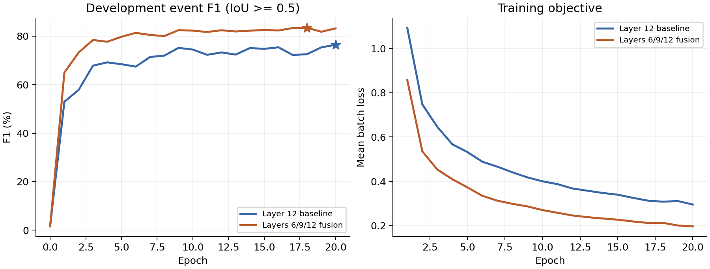

# 冻结WavLM多层融合：实测报告

本次单种子对照中，融合的事件F1提高，按录音配对的95%置信区间完全高于0。

## 改动与对照

- 基线：第12层输出；融合：第6、9、12层输出经softmax权重加权求和。
- WavLM的94,381,936个参数全部冻结；融合只增加3个可学习标量，权重初始均为1/3。
- 原有源码未修改。两组使用相同随机初始化、数据顺序、三种音频视图、投影、CNN/GRU、双分辨率模块及损失。
- 固定数据：训练6,345条、开发2,484条、测试3,562条；seed=666，各20轮，batch=8，AdamW lr=0.001。
- 开发集真实时长FPR≤5%校准阈值，按开发集事件F1选模型。全部训练完成后冻结权重及阈值，才进行测试评价。

## 测试集指标

| 指标 | 第12层基线 | 三层融合 | 融合−基线（百分点） |
|---|---:|---:|---:|
| 事件F1（IoU≥0.5，↑） | 65.2588% | 73.6767% | +8.4179 |
| 事件精确率（↑） | 61.7179% | 70.9014% | +9.1835 |
| 事件召回率（↑） | 69.2308% | 76.6780% | +7.4473 |
| ≤320ms短事件召回率（↑） | 66.7273% | 72.6020% | +5.8747 |
| 真实时长误报率（↓） | 6.8283% | 5.7043% | -1.1239 |
| 20ms帧F1（↑） | 84.4350% | 90.0013% | +5.5662 |
| 帧EER（↓） | 12.3540% | 8.4517% | -3.9023 |

## 开发集选择与融合权重

| 方案 | 最佳轮次 | 开发集事件F1 | 冻结阈值 | 层6 / 层9 / 层12权重 |
|---|---:|---:|---:|---|
| layer12 | 20 | 76.4277% | 1.05186844 | 0.0000 / 0.0000 / 1.0000 |
| fusion6_9_12 | 18 | 83.4082% | -0.17905921 | 0.7043 / 0.1493 / 0.1464 |

## 配对不确定性估计

以录音为单位进行2,000次配对bootstrap，重采样时两组使用同一批录音；区间单位为百分点。

| 差值 | 点估计 | 95%区间 |
|---|---:|---|
| event_f1_iou05_percent | +8.4179 | [+7.3685, +9.4339] |
| short_event_recall_le320ms_percent | +5.8747 | [+4.6779, +7.0367] |
| real_duration_fpr_percent | -1.1239 | [-1.6372, -0.6315] |

## 验证与限制

- 新基线与原后端初始化及输出完全一致；真实音频第12层缓存与原提取器逐元素相等。
- 三层融合权重可正常收到梯度；编码器全部冻结；训练、模型选择、冻结、评价、单音频预测均已验证。
- 一共63项单元测试通过；小样本预测与缓存评价分数完全一致。
- 这里只比较预先指定的第6、9、12层融合，没有用测试集搜索层组合或调整阈值。
- 本实验验证的是三层加权融合整体相对第12层的效果，不单独证明每层或学习权重相对固定平均的贡献。
- 单随机种子；bootstrap只反映当前两个固定模型在录音采样上的不确定性，不包含重训波动。
- 测试集在项目历史中已经被查看过，结果属于既有测试集上的增量实验。
- 本机重新训练的基线可能因运行环境与历史报告不同而有差异；结论以这次相同条件的对照为准。

## 产物

- 同机重训基线权重未随本发布包上传；其指标、逐录音结果、分数和检查点哈希保存在 `training/layer12/`。
- [`../weights/best.pt`](../weights/best.pt)：本次最佳融合模型，保持原始文件字节与SHA256不变。
- `training/*/history.json`：逐轮训练及开发集指标。
- `training/*/eval_metrics.json`：全部测试指标。
- `training/frozen_eval_plan.json`：测试前冻结的权重及阈值。
- `paired_bootstrap.json`：配对置信区间。
- `verification_summary.json`：汇总及原源码未改动检查。

## 原模型复现核对

原有WavLM权重使用新增缓存的第12层特征，在全部2,484条开发录音上按原阈值评价。

| 指标 | 复现值 | 与原权重归档指标差值（百分点） |
|---|---:|---:|
| event_f1_iou05_percent | 76.95752077% | +0.00000000 |
| short_event_recall_le320ms_percent | 72.98013245% | +0.00000000 |
| real_fpr_percent | 4.99960322% | +0.00000000 |

## 最终权重单音频推理核对

| 方案 | 最大分数绝对差 | 不同判定帧数 | 阈值完全一致 |
|---|---:|---:|---|
| layer12 | 0 | 0 | True |
| fusion6_9_12 | 0 | 0 | True |

使用同一条开发录音比较原始音频直接推理和该最佳权重归档的缓存评价分数。
