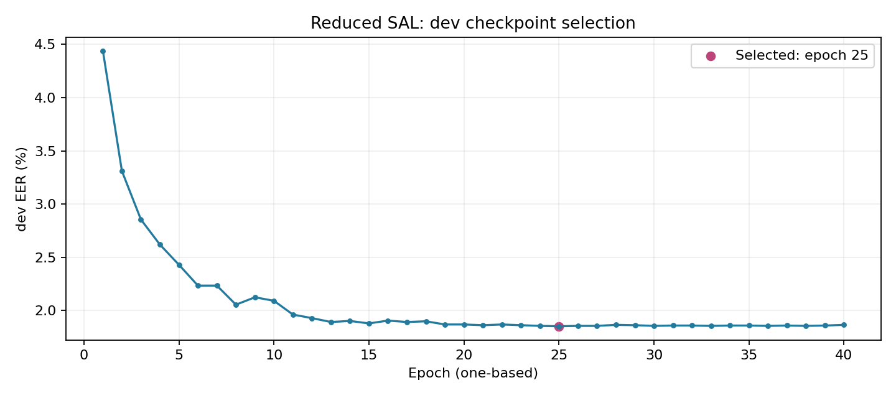
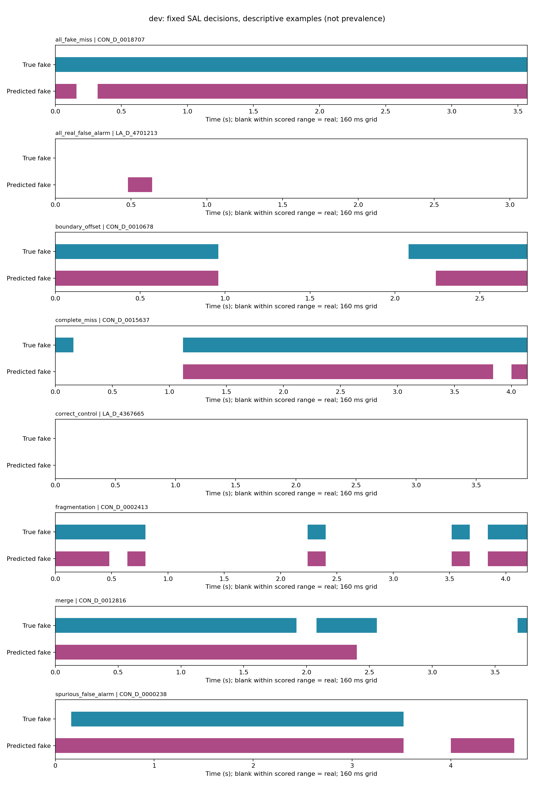
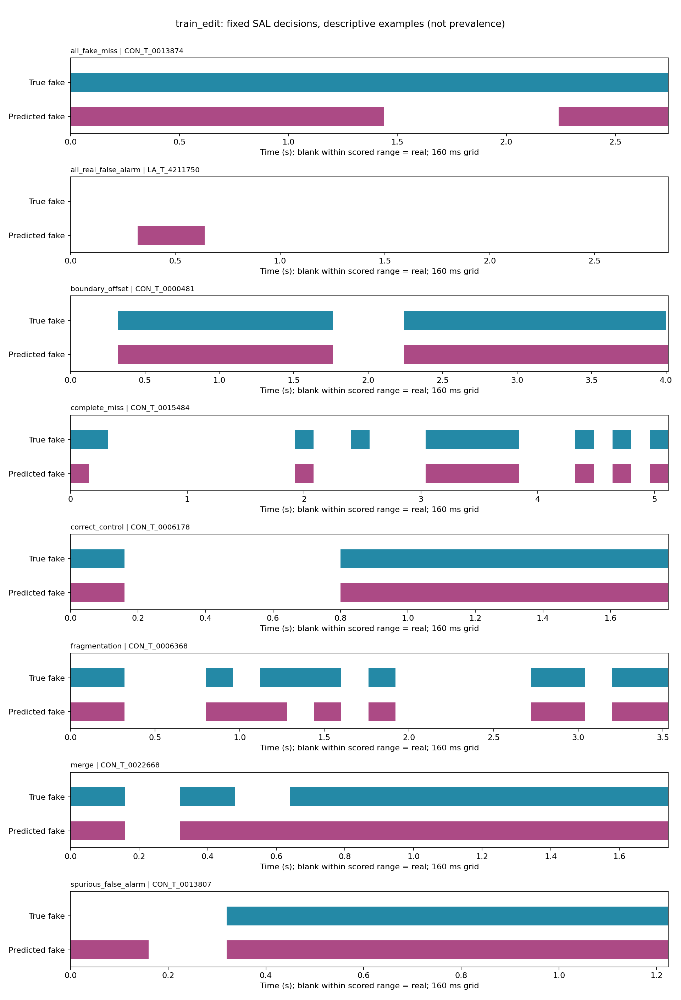

# 2026-11-12 缩减 SAL 冻结基线：指标、区间与错误

这是本次实际完成的缩减训练结果。新目录独立保存结果，未覆盖原源码、历史结果或其他小组分支。

- train_detector 5,076 条；seed 888；batch 8；40 轮结束；dev 选第 25 轮。
- 通用 WavLM 初始化、新 SAL 任务参数；不是公开全量 PS SAL 成品。
- CSM：`aligned_cross_recording_v1`；验证 EER：`official_formula_cpu_v1`。
- 所有结果共用 SHA256：`6b05b7406e20b719c7a55ea40c90905fda7f9d4f01ea7d3d50604d7c40c7d4ff`。
- **本次没有新 eval/LPS 结果，不能据这些 PS 数据断言 LPS 泛化改善。没有实现收益网络或新语义方法。**

## 先看结果

| 数据角色 | 条数 | EER % | 伪造类 F1 % | 真实类 F1 % | 准确率 % | 漏检帧 | 误报帧 |
|---|---:|---:|---:|---:|---:|---:|---:|
| dev（选模） | 2,484 | 1.852528 | 98.301031 | 97.973495 | 98.151657 | 526 | 497 |
| train_edit（冻结后的研究） | 1,269 | 1.857384 | 98.271702 | 97.897827 | 98.103012 | 330 | 200 |
| train_review（仍预留） | 1,269 | 1.861578 | 98.329499 | 97.978775 | 98.170799 | 296 | 205 |

完整精度：[metrics_summary.csv](metrics_summary.csv)。每个角色的原始 metrics.json 还包含混淆矩阵、阈值定义、运行时间、数据/模型来源和版本。
这里 dev 被用于选择 checkpoint，不能作为独立测试成绩；三个角色都没有用于训练这次 SAL 的任务参数。

F1/准确率/区间使用原始二分类 head 的 argmax，不使用 EER 交点阈值；分数相等按 SAL 选类别 0。`0=伪造，1=真实`。EER 按原公式对连续 `logit_real-logit_fake` 排序，与区间指标分开。F1 为逐帧口径，不是事件 F1。



## 预测哪些是真实、哪些是伪造

| 角色 | 区间表（适合直接查看） | 每条录音一行（适合程序读取） | 原始缓存及分数 |
|---|---|---|---|
| dev | [intervals.csv](predictions/dev/intervals.csv) | [intervals.jsonl](predictions/dev/intervals.jsonl) | [目录](predictions/dev) |
| train_edit | [intervals.csv](predictions/train_edit/intervals.csv) | [intervals.jsonl](predictions/train_edit/intervals.jsonl) | [目录](predictions/train_edit) |
| train_review | [intervals.csv](predictions/train_review/intervals.csv) | [intervals.jsonl](predictions/train_review/intervals.jsonl) | [目录](predictions/train_review) |

- `uid` 对应原数据清单中的录音 ID；音频在原数据包的对应角色目录，不在本次结果目录重复上传。
- `predicted_fake` / `predicted_real` 是模型输出，`true_fake` / `true_real` 是缓存中的真值，**不是额外输入模型的特征**。
- 时间单位为秒，区间为 `[start, end)`；原 PS 标签/预测网格为 **160 ms**，最后一帧裁到实际音频长度，不能解释成更高精度定位。
- `unscored_tail` 若存在，表示未评分尾部，不能自动当真实。当前三个角色都完整覆盖实际音频。
- `frames.csv` 保存逐帧真实/预测类别、两个 logits、margin 和未校准的二分类 softmax；`predictions.sqlite` 保留原始缓存字节。
- dev/train_edit 的 JSONL 另含 `false_negative_intervals`（假判真）和 `false_positive_intervals`（真判假）。train_review 仅导出原预测和真值，不做错误样例选择或开发分析。

## 它会犯哪些错误

下面是固定模型/固定 argmax 的描述性诊断，没有调阈值、平滑、填洞或候选筛选。不是新方法对照成绩。

| 错误或指标 | dev | train_edit |
|---|---:|---:|
| 漏检时长 | 83.0188125 s | 52.158625 s |
| 误报时长 | 78.032 s | 30.77475 s |
| 真伪造事件总数 | 6,903 | 3,513 |
| 整个真事件完全漏检 | 70 | 38 |
| 碎片化的真事件 | 110 | 55 |
| 合并了多个真事件的预测段 | 111 | 46 |
| 与任何真事件都不相交的误报段 | 56 | 23 |
| 匹配后仍有边界偏差的事件对 | 554 | 294 |
| 事件 F1（tIoU≥0.5，一对一） | 95.420290% | 95.927086% |

**dev 的漏检分解**：内部空洞 24.800 s，首尾缺失 45.58825 s，整事件漏掉 12.6305625 s；三者之和等于 83.0188125 s。当前 PS dev 与旧 LPS 的错误结构不同，不能将历史 LPS 比例套用到本次结果。

**短事件值得单独看**：dev 中 ≤160 ms 的 2,368 个真事件，有 60 个完全漏检、2,193 个达到一对一 tIoU 匹配；70 个完全漏检中有 60 个来自这个最短组。≤160 ms 也是当前标签分辨率边界，不能据此推断亚帧真实声学边界。

**全真/全假分开看**：dev 的 255 条全真录音有 2.56 s 误报（8 个孤立预测段）；117 条全假录音有 0.9158125 s 漏检、3 个事件被碎片化。定义均基于缓存的有效网格标签。

详细诊断：[dev](diagnostics/dev)、[train_edit](diagnostics/train_edit)。其中 `recording_errors.csv` 可按 uid 查录音错误，`true_event_errors.csv` 可查每个真事件的覆盖、匹配及边界偏差，`summary.json` 包含全真/全假/局部、短事件分层。

类别定义：完全漏检=无任何预测重叠；碎片化=一个真事件重叠至少两个预测段；合并=一个预测段重叠至少两个真事件；孤立误报=无真事件重叠。边界偏差只在最大匹配数优先的一对一 tIoU≥0.5 匹配对中统计。类别可重叠，分母不同，**不可直接相加**。本次没有计算置信区间，不能把小幅指标差异解释为显著增益。

下图从每类全部合格录音中按固定 SHA256 顺序选一个例子，没有挑最差样本；例子只解释形态，不代表发生比例。青色是真伪造区间，紫色是预测伪造区间，评分范围内空白是真实。





## 下载训练权重

[打开本次 Release：sal-reduced-20261112-run122313](https://github.com/HarperLee0530/Partial-Speech-Deepfake-Localization/releases/tag/sal-reduced-20261112-run122313)。仓库是私有的，下载者需要仓库访问权限。

原始最佳 checkpoint 为 4,037,008,368 字节，保留训练元数据与优化器状态。Release 中按原字节切为三个分片，没有重存或压缩权重；Git 文件夹内不放 4 GB 二进制。

下载 `sal_best_epoch024.ckpt.part001`、`part002`、`part003`，以及 `weights_manifest.json`、`reassemble_checkpoint.py` 到同一个目录，然后运行：

```powershell
python reassemble_checkpoint.py --parts-dir . --output "best-epoch=024.ckpt"
```

脚本逐片校验，再核对完整权重 SHA256；不会覆盖已有文件。重组后应得到前述 `6b05b740…c40c7d4ff`。
若恢复原项目目录，请放到 `data/models/sal_train_reduced_20261112_122313_966079/best-epoch=024.ckpt`。

Release 另附 `01_code_evidence_caches.zip`：原训练时的完整源码快照、缓存及交接证据。该旧交接 ZIP 的说明提到另一个整包权重 ZIP；本次 GitHub 传输改用上述原始 checkpoint 分片，重组到指定模型路径后仍可使用其中的 `verify_handoff.py`。新的区间导出和错误诊断以当前 Git 目录为准。

## 复现、身份和已知限制

训练基准提交 `77b2dc374a6884edf432b696c3bc47e5cc47b368` 加三个本机文件修复。确切修改及配置见 [source_snapshot](source_snapshot)，完整代码见 Release 源码包；本次没有覆盖仓库当前主分支源码。首次失败发生于 0 步，修复严格确定性下验证 EER 的 CUDA cumsum 问题后顺序重试，CSM 版本和训练配置保持原样。

[training](training) 包含每轮指标 CSV、原始训练日志、实际解析配置、训练记录及冻结身份；[audit](audit) 保存验收和方法审阅。历史日志中的本机绝对路径仅用于溯源，换机应使用目录内相对路径。

区间导出实际核对全部录音 ID、SQLite 完整性、混淆矩阵一致性、区间回转逐帧一致性，见 [verification.json](verification.json)。四项额外契约测试覆盖最后帧裁剪、尾部、argmax 平分、事件匹配，见 `test_export_contract.py`。逐文件校验见 `files_manifest.json`。

复跑导出（只读缓存，无 GPU 推理；输出必须为新目录）：

```powershell
python export_results.py --project-root PATH_TO_ORIGINAL_PROJECT --output NEW_OUTPUT_DIRECTORY
```

后续应复用同一 checkpoint/cache，先做候选覆盖与 oracle 上限、同预算规则，再决定是否加收益网络。train_review 继续预留。新 eval/LPS 评价、方法指标与 PS 容忍范围尚未完成；LPS 已有历史探索，不能称新盲测。
